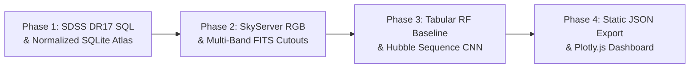
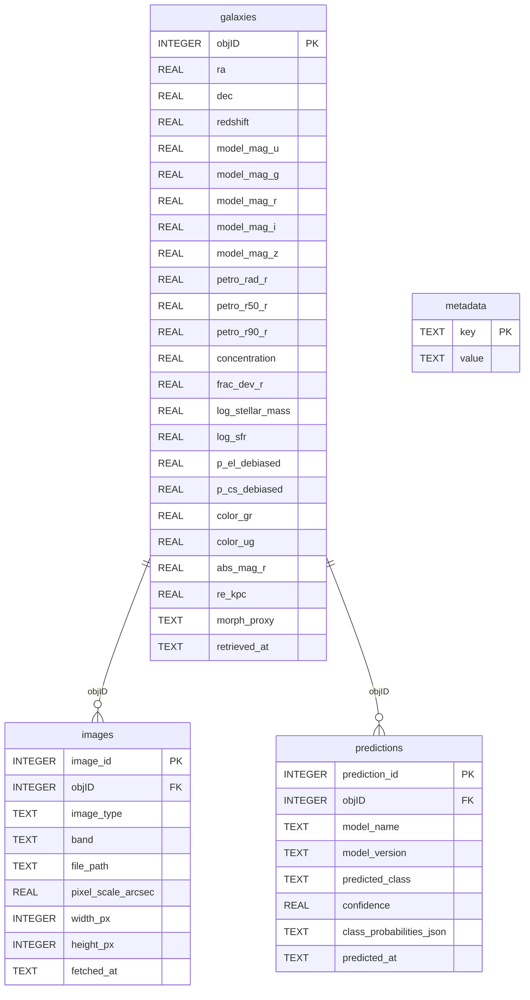

# Architecture — SDSS Galaxy Morphology & Scaling Relations Atlas

This document specifies the four-phase architecture, astrophysical conventions, and normalized SQLite data model for the **SDSS Galaxy Morphology & Scaling Relations Atlas**.

---

## 1. Four-Phase Roadmap

### Phase 1 — Catalog Acquisition, Cosmological Physics & SQLite Atlas (Current)
- Query SDSS DR17 via `astroquery.sdss.SDSS.query_sql`, joining `PhotoObj`, `SpecObj`, `galSpecExtra` (MPA-JHU stellar masses and SFRs), and `LEFT JOIN zooSpec` (Galaxy Zoo 1 debiased vote fractions).
- Apply a clean, volume-limited local-Universe selection:
  - `0.02 <= s.z <= 0.10`
  - `p.modelMag_r < 17.77` (SDSS Main Galaxy Sample spectroscopic completeness limit)
  - `p.type = 3` (photometric galaxy)
  - `s.class = 'GALAXY'` (spectroscopically confirmed galaxy)
  - `s.zWarning = 0` (clean spectroscopic redshift)
- Persist raw query output to `data/raw/sdss_catalog_raw.csv`, filter sentinel values (e.g., `-9999`), compute physical parameters under a `FlatLambdaCDM` cosmology ($H_0 = 70\ \mathrm{km\,s^{-1}\,Mpc^{-1}}$, $\Omega_{m0} = 0.3$), and upsert into `data/galaxy_atlas.db`.
- Run parameterized analytical SQL queries into Pandas and produce diagnostic scaling-relation plots.

### Phase 2 — Automated Image Acquisition (Complete)
- **`SkyServerRGBDownloader` (`src/imaging.py`)**: Multi-threaded, resumable downloader fetching `128 × 128` px SDSS DR17 RGB JPEG cutouts (`0.396 arcsec/px` native scale, `50.7" × 50.7"` FoV) via `SkyServerWS/ImgCutout/getjpeg` with automatic failover to the Legacy Survey SDSS cutout layer (`layer=sdss`), validating every image with `Pillow`, saving to `data/processed/rgb_cutouts/{objID}.jpg`, and upserting records into SQLite `images` (`image_type = 'rgb_cutout'`, `band = 'gri'`).
- **`MultiBandFITSProcessor` (`src/imaging.py`)**: Selects a balanced showcase subset (half early-type elliptical, half late-type spiral), resolves `(run, rerun, camcol, field)` from SDSS DR17 `PhotoObj`, downloads calibrated `g, r, i` FITS frames from SDSS SAS (`data/raw/fits/`), extracts sky-centered `128 × 128` px cutouts with `astropy.nddata.Cutout2D`, masks NaN/Inf pixels with sigma-clipped sky medians, writes clean FITS cutouts (`data/processed/fits_cutouts/`), synthesizes arcsinh-stretched RGB composites via `astropy.visualization.make_lupton_rgb(i, r, g)` (`data/processed/lupton_rgb/`), and registers all assets (`fits_cutout` + `lupton_rgb`) in SQLite `images`.

### Phase 3 — Dual-Track Morphological Classification (Complete)
Implemented in **two separate, self-contained packages** under `classifiers/`:
- **Track 1 — Referenced Astronomy Packages (`classifiers/astronn_and_astroml/`)**:
  - `tabular_baseline.py` (`PhotometricMorphologyClassifier`): `scikit-learn` Random Forest + HistGradientBoosting (following `astroML` photometric classification) trained on 8 physical parameters (excluding `frac_dev_r` to prevent leakage) against Galaxy Zoo consensus labels; stores predictions for all `2,489` galaxies in SQLite (`model_name = 'rf_photometric_baseline'`).
  - `astronn_classifier.py` (`AstroNNGalaxy10Pipeline`): Uses `astroNN.datasets.galaxy10sdss` (`load_data`, `galaxy10cls_lookup`) and the canonical 4-layer `Galaxy10CNN` architecture with **Monte Carlo Dropout** epistemic uncertainty estimation ($\sigma_{\text{MC}}$), mapping 10-class Galaxy10 posteriors into 5 Hubble Sequence categories (`model_name = 'astronn_galaxy10_cnn'`).
- **Track 2 — Custom TensorFlow / Keras CNN (`classifiers/tensorflow_cnn/`)**:
  - `cnn_model.py` & `train_and_predict.py`: Custom 4-block `Conv2D + BatchNormalization + ReLU + MaxPooling2D` CNN built from scratch with TensorFlow/Keras, incorporating built-in 360° astronomical rotational & reflection invariance (`RandomFlip`, `RandomRotation(0.5)`), `GlobalAveragePooling2D`, class-weighted sparse cross-entropy, and Hubble Sequence classification (*Elliptical*, *Lenticular/Edge-on*, *Tight Spiral (Sa)*, *Medium Spiral (Sb)*, *Loose Spiral / Irregular (Sc/Irr)*; `model_name = 'tensorflow_hubble_cnn'`).

### Phase 4 — Zero-Backend Interactive Web Atlas (Complete)
- `src/export_dashboard.py` exports `v_galaxy_dashboard`, `predictions`, `images`, power-law fits, correlation matrices, and model benchmarks to `web/data/atlas_data.json` and `web/data/atlas_data.js` (serializing 64-bit `objID` as exact strings for JavaScript safety).
- `web/` (`index.html`, `styles.css`, `app.js`) serves a self-contained Plotly.js dashboard with live cross-filtering, a sticky Galaxy Inspector (with SDSS RGB / FITS Lupton toggle and 3-model probability bars), FITS showcase gallery, ML/CNN benchmark visualizations, and searchable catalog explorer.

---

## 2. Physical & Cosmological Conventions

All numeric database columns are stored strictly as unitless SQLite `REAL` values (never strings with embedded units). Units are fixed by contract:

| Column | Physical Quantity | Unit / Convention | Derivation |
| :--- | :--- | :--- | :--- |
| `ra`, `dec` | Equatorial coordinates (J2000) | degrees | SDSS `PhotoObj` |
| `redshift` | Spectroscopic redshift $z$ | dimensionless | SDSS `SpecObj.z` |
| `model_mag_{u,g,r,i,z}` | Apparent SDSS model magnitudes | AB mag | SDSS `PhotoObj.modelMag_*` |
| `petro_rad_r` | $r$-band Petrosian radius | arcsec | SDSS `PhotoObj.petroRad_r` |
| `petro_r50_r` | $r$-band 50% light Petrosian radius | arcsec | SDSS `PhotoObj.petroR50_r` |
| `petro_r90_r` | $r$-band 90% light Petrosian radius | arcsec | SDSS `PhotoObj.petroR90_r` |
| `concentration` | Light concentration index $C = R_{90}/R_{50}$ | dimensionless | `petroR90_r / petroR50_r` |
| `frac_dev_r` | de Vaucouleurs profile weight | dimensionless $[0, 1]$ | SDSS `PhotoObj.fracDeV_r` |
| `log_stellar_mass` | Median total stellar mass | $\log_{10}(M_\star / M_\odot)$ | `galSpecExtra.lgm_tot_p50` |
| `log_sfr` | Median total star formation rate | $\log_{10}(\mathrm{SFR} / (M_\odot\,\mathrm{yr}^{-1}))$ | `galSpecExtra.sfr_tot_p50` |
| `p_el_debiased` | Galaxy Zoo debiased elliptical vote fraction | dimensionless $[0, 1]$ (nullable) | `zooSpec.p_el_debiased` |
| `p_cs_debiased` | Galaxy Zoo debiased spiral vote fraction | dimensionless $[0, 1]$ (nullable) | `zooSpec.p_cs_debiased` |
| `color_gr` | Optical $(g - r)$ color | mag | `modelMag_g - modelMag_r` |
| `color_ug` | Near-UV/optical $(u - g)$ color | mag | `modelMag_u - modelMag_g` |
| `abs_mag_r` | Absolute $r$-band magnitude $M_r$ | AB mag | `modelMag_r - distmod(z)` |
| `re_kpc` | Physical half-light radius $R_{50}$ | kpc | `petroR50_r * kpc_proper_per_arcmin(z) / 60` |
| `morph_proxy` | Baseline structural morphology label | `"early"` / `"late"` | `"early"` if `fracDeV_r >= 0.5` else `"late"` |

Cosmology: `astropy.cosmology.FlatLambdaCDM(H0=70.0, Om0=0.3)`.

---

## 3. Normalized SQLite Schema (`data/galaxy_atlas.db`)

Foreign key enforcement (`PRAGMA foreign_keys = ON`) is enabled on every connection, and all DDL statements are idempotent (`CREATE ... IF NOT EXISTS`).

### Indexes
- `idx_galaxies_redshift` on `galaxies(redshift)`
- `idx_galaxies_morph_proxy` on `galaxies(morph_proxy)`
- `idx_images_objid` on `images(objID)`
- `idx_predictions_objid_model` on `predictions(objID, model_name)`

### Dashboard View (`v_galaxy_dashboard`)
Joins `galaxies` with the most recent RGB cutout record in `images` and the latest model prediction in `predictions` so downstream analytics and Phase 4 JSON exports can read a single unified relation without denormalizing the core tables.
